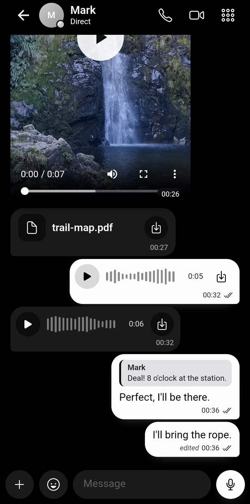
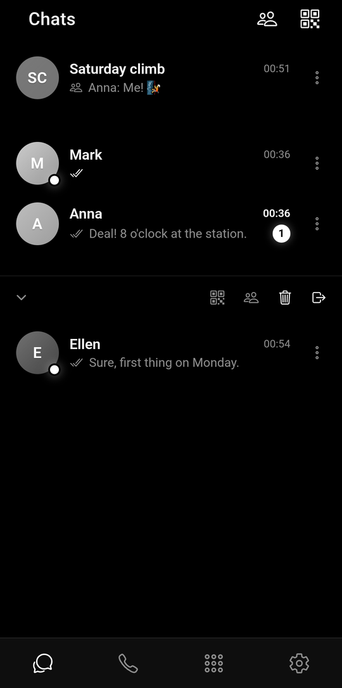
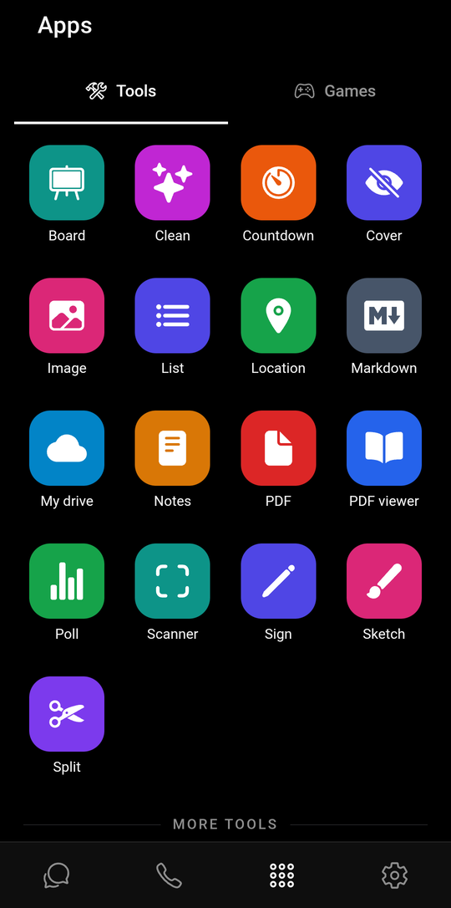

# FlickerTalk

[](https://github.com/FlickerTalk/app/actions/workflows/app.yml)

FlickerTalk is a private messenger: texts, photos and files, voice messages, and voice and video
calls. No account. No phone number required. No activity logs. Your chat history stays on your
phone, not on our servers. [flickertalk.com](https://flickertalk.com)

- **Android:** [Google Play](https://play.google.com/store/apps/details?id=com.flickertalk.app),
  or the APK from [GitHub Releases](https://github.com/FlickerTalk/app/releases)
  (see [Verifying an APK](#verifying-an-apk)).
- **iPhone:** coming soon on the App Store.
- **Video:** [the trailer](https://youtu.be/QNMZLA05s7c) (1 min) and
  [the full manual](https://youtu.be/rQNRywOx_P8) (24 min).

<p>
  
  
  
</p>

## What it does

- **No account:** no phone number, no email, no password. Your identity is a key made on your
  phone; you add people by scanning their code or opening their link. We have no directory of
  users and never see your address book.
- **Phone to phone:** messages travel directly between phones when possible, over an encrypted
  WebRTC connection, end-to-end encrypted with Olm (vodozemac). When a direct path is impossible,
  our relay carries the same encrypted traffic.
- **Optional mailbox:** if the other phone is offline, an optional mailbox holds your message
  end-to-end encrypted. It is deleted when picked up, or after 7 days at the latest. We cannot
  read it. If either of you turns the mailbox off, the message waits on the sender's phone until a
  direct connection is possible.
- **Files and calls** are one to one and never go through the mailbox. During a call you can
  present a whiteboard or a PDF, page by page.
- **Circles:** a small, closed group of your contacts, up to 32 members, for text messages. Our
  server keeps no record of circles.
- **Sessions with a PIN:** a separate space, with its own contacts and PIN.
- **Per-contact rules:** mute, accept only messages or only calls, turn receipts off, keep history
  for a while or delete after reading; weekly quiet hours.
- **Tools and games:** 17 tools and 13 games are in the Apps tab, from a signed catalogue: install
  only the ones you want. Each one runs in isolation and gets only what you allow it, never your
  chat history, your contacts or your keys.
- No advertising. No analytics. No tracking profiles.

The app is free to use; the tools and extra PIN-protected sessions are an optional Premium
subscription, with a 15-day trial.

## What our server knows, and what it does not

Our server is a small router ([FlickerTalk/server](https://github.com/FlickerTalk/server)). It is
not a chat server: it wakes phones, passes connection offers between them, and holds messages that
could not be delivered yet, end-to-end encrypted. For each phone it keeps:

| Data | Why | For how long |
| --- | --- | --- |
| Device ID (`ft_` + base58 of the BLAKE3 hash of the public key) and the Ed25519 public key | To check that a request is signed by that phone | Until you erase the phone in the app |
| BLAKE3 hashes of the phone's eight routing codes, one per space: the main list and up to seven sessions with a PIN. All eight are registered, used or not | Only someone with a routing code, which travels in your contact card, can wake you or leave you a message | Same |
| Push provider (Google or Apple) and push token, encrypted with a key kept outside the database | To wake the phone | Same, or until Google or Apple report the token invalid |
| Eight bits (`silent_slots`), one per space, marking the sessions you have left | So that a session you have left gets no wake-ups or calls. We can see when a bit changes, not who is in a session | Replaced at every registration |
| Time of the last registration or push token change (`updated_at`) | Written with the record; nothing uses it yet | Same as the device ID |
| Messages that could not be delivered: end-to-end encrypted, sealed again for the recipient, without sender. Each has an ID that contains the time it was left, an expiry time and the number (0–7) of the space it came through | To deliver them later | Until the recipient's phone confirms it has them, at most 7 days |

The mailbox is an `UNLOGGED` PostgreSQL table: it never reaches the write-ahead log or a backup.
The device records are in our database backups, which are encrypted before they leave the server.

Held in memory only, never written to disk:

- connection offers and answers for a phone that is not connected, end-to-end encrypted: at most
  55 seconds;
- which phones are connected right now;
- the nonces of recent signed requests, for a few minutes, to refuse replays;
- rate-limit counters, for one minute, per device, per recipient and per connection address
  hashed with a salt made at start;
- how many suggestions each device sent in the last 24 hours.

Nothing else: no contacts or address books, no circles or their members, no conversations, no call
history, no names, phone numbers or email addresses, no access logs and no history of IP addresses.
The whole API is in
[`ft-router/src/v1.rs`](https://github.com/FlickerTalk/server/blob/main/ft-router/src/v1.rs):
register, erase, set or clear the push token, connect (WebSocket), signal, leave a message, collect
and acknowledge messages, get TURN credentials, and send a suggestion (forwarded by email, not
stored). There is no endpoint for messages, conversations, users, profiles, history or attachments.

While a request or a connection is open, the server sees its IP address and, if it is signed,
which phone made it. Mailbox messages and connection offers are not signed by the sender: they
need only the recipient's routing code.

## What it does not protect

- During a direct connection, the other phone can see your public IP address. In Settings you can
  make calls always go through our relay, which hides it from the other person during calls.
- When a direct connection is impossible, our relay carries the encrypted traffic. It sees the IP
  addresses of both phones and how much data flows, never the content, and it keeps no logs.
- Google or Apple deliver the wake-up notification, so they see that your phone got one and when,
  and whether it is a call. The notification never contains a message or who sent it; besides its
  kind, it carries only a number from 0 to 7 that tells your phone which of its spaces it is for.
- On Android, the wake-up goes through Firebase Cloud Messaging, which needs Google Play services.
  Without them the app works while it is open, but a closed app is not woken: messages wait until
  you open it, and calls do not ring.
- Both people need FlickerTalk. Chats, files and calls are one to one; circles are small groups,
  up to 32 members, for text only. Your identity lives on one phone: there are no linked devices
  and no desktop app.
- A contact added by link is only as trustworthy as the channel the link came through. To be sure,
  compare the security fingerprint on the contact's page in person.
- If you uninstall the app without using **Erase this phone** first, your device record stays on
  our server; the push token is dropped once Google or Apple report it invalid.
- No app can protect you from a phone that is compromised or unlocked in someone else's hands,
  from malware, from screenshots, or from the people you write to copying what you send.
- FlickerTalk itself has not been audited. The encryption library it uses, vodozemac, had a
  [public audit in 2022](https://matrix.org/blog/2022/05/16/independent-public-audit-of-vodozemac-a-native-rust-reference-implementation-of-matrix-end-to-end-encryption/),
  of an earlier version than the one we use.

Who can see what, party by party: [how it works](https://flickertalk.com/how-it-works/).

## How it is encrypted

- **Identity.** Each phone creates an Olm account with vodozemac: an Ed25519 key and a Curve25519
  key. They are stored encrypted, with a key that the phone's key store (Android Keystore, iOS
  Keychain) seals. Your FlickerTalk ID is `ft_` plus the base58 BLAKE3 hash of the Ed25519 public
  key; your phone signs its own requests to our server with that key.
- **Contacts.** You add someone with their contact card, a QR code or link signed with their key,
  which carries their public keys and a routing code. Each contact's page shows a security
  fingerprint to compare in person.
- **Messages.** Olm (a Double Ratchet), from vodozemac. Packets are versioned CBOR
  ([`crates/ft-protocol`](crates/ft-protocol/src/lib.rs)), padded to a multiple of 160 bytes
  before they are encrypted. The same encrypted packet travels over the direct connection or
  through the mailbox.
- **Through our server.** Mailbox messages and connection offers are sealed a second time for the
  recipient alone (a NaCl sealed box: X25519 and XSalsa20-Poly1305, from the `crypto_box` crate),
  so what the server handles does not name the sender.
- **The direct connection.** WebRTC: DTLS for the data channel, DTLS-SRTP for calls. The offer and
  answer that set it up are encrypted with Olm, so the DTLS fingerprint in each one is bound to
  your contact's identity: the server that relays them cannot put itself in the middle.
- No cryptography of our own: we use these libraries as they are.

## Build and test

This repository is the whole client: the Tauri 2 app (Vue 3 + Ionic in `src/`, Rust in
`src-tauri/`) and the Rust core in `crates/ft-*`, which holds the business logic. Android and iOS
are the target platforms; desktop builds but is not published.

What CI uses; other versions may work:

- Node.js 22 and npm.
- Rust stable, with `clippy` (release 1.6.0 was built with Rust 1.99.0).
- On Linux, for the Rust tests:
  `libwebkit2gtk-4.1-dev libayatana-appindicator3-dev librsvg2-dev libssl-dev`.
- Android: JDK 17, the Android SDK (API 36) and an Android NDK, with `ANDROID_HOME` and `NDK_HOME`
  set, and the Rust targets
  `aarch64-linux-android armv7-linux-androideabi i686-linux-android x86_64-linux-android`.
- iOS: macOS with Xcode 27, `rustup component add llvm-tools` (see below) and your own Apple team.

```sh
npm ci
npm run typecheck
npm test                          # frontend tests (Vitest)
npx playwright install chromium   # once
npm run test:e2e                  # the real UI against a fake core (Playwright)
cargo clippy --workspace --all-targets --locked -- -D warnings
cargo test --workspace --locked   # Rust tests, no network
```

Android:

```sh
npm run tauri android dev               # on a phone or an emulator
npm run tauri android build -- --apk    # release APK (see the Google client ids below)
# Kotlin tests of the bridge, after one `tauri android dev` or `build`:
(cd src-tauri/gen/android && ./gradlew :tauri-plugin-ft-platform:testDebugUnitTest)
```

A release build is signed when `src-tauri/gen/android/keystore.properties` exists or
`ANDROID_UPLOAD_KEYSTORE_FILE`, `ANDROID_UPLOAD_KEY_ALIAS` and `ANDROID_UPLOAD_PASSWORD` are set;
otherwise it is unsigned. Without `src-tauri/gen/android/app/google-services.json` from your own
Firebase project, the app builds, but it cannot be woken while it is closed.

iOS:

```sh
APPLE_DEVELOPMENT_TEAM=<your team> scripts/ios-build.sh [device-udid]   # debug build on an iPhone
# Swift tests of the bridge, on a simulator, after one iOS build:
(cd src-tauri/platform/ios && xcodebuild test -scheme tauri-plugin-ft-platform \
  -destination 'platform=iOS Simulator,name=<simulator>')
```

iOS release builds with Xcode 27 also need `rustup component add llvm-tools`: the patched
`swift-rs` in `Cargo.toml` uses its `llvm-objcopy` to export the Swift entry points that Xcode 27
leaves local (see the comment there).

Google Drive sign-in needs the app's OAuth client ids at build time: `FT_GOOGLE_CLIENT_ID`
(Android) and `FT_GOOGLE_IOS_CLIENT_ID` (iOS), both `<id>.apps.googleusercontent.com`. A release
build for Android or iOS stops without its platform's id (`src-tauri/build.rs`); a debug build only
warns and cannot sign in. A release that is never published can build without it with
`FT_ALLOW_NO_GOOGLE_CLIENT=1`. `tauri ios build` only passes `TAURI*` variables to the Xcode build,
so for iOS export the id as `TAURI_FT_GOOGLE_IOS_CLIENT_ID` (also read; the plain name wins).

Builds are signed and published by GitHub Actions: every push to `main` produces a `canary`
prerelease, and every `vX.Y.Z` tag a release with the APK and the AAB.

### Reproducible builds

Not yet. The Rust toolchain and the Android NDK are not pinned, and the published APK contains
configuration values that are not in this repository (the Firebase project and the Google sign-in
client id), so you cannot yet check that our APK matches this source byte for byte.

### Verifying an APK

The APK on [GitHub Releases](https://github.com/FlickerTalk/app/releases) is signed with our upload
key. Google Play signs the app it installs with its own key. Package `com.flickertalk.app`:

| Source | Certificate SHA-256 |
| --- | --- |
| GitHub Releases | `97:C2:84:62:4C:46:71:05:81:FB:63:E5:1F:E0:2C:CB:42:AF:06:EA:73:35:C5:20:98:29:51:CA:E9:7E:0F:6B` |
| Google Play | `D2:08:CB:64:1F:C6:26:B1:49:9F:8A:85:9E:33:65:2B:DD:36:94:A3:63:49:38:EE:9B:1C:D7:40:2A:29:E0:5B` |

Both are also in [assetlinks.json](https://flickertalk.com/.well-known/assetlinks.json). Check an
APK with `apksigner verify --print-certs FlickerTalk-X.Y.Z.apk` (it prints the digest in lower
case, without colons). Because the keys differ, Android will not update an install from one source
with the other: switching means uninstalling, which erases FlickerTalk's data on that phone.

## The server

The router is in [FlickerTalk/server](https://github.com/FlickerTalk/server) (Rust, Axum,
PostgreSQL). That repository's CI publishes the image `ghcr.io/flickertalk/ft-router` and, on each
version tag, deploys it to `api.flickertalk.com`;
[`https://api.flickertalk.com/version`](https://api.flickertalk.com/version) answers the version
it runs. STUN and TURN run on our own servers (coturn) with logging off; the router hands out
short-lived TURN credentials with random user names.

You cannot check from outside which code our server runs. That is why messages are encrypted on
the phone before they reach it, and why this README lists what the server keeps and what it sees.

The public router serves the official FlickerTalk apps only. A fork runs its own router from
FlickerTalk/server and points the app at it with `ROUTER` in
[`src-tauri/src/client.rs`](src-tauri/src/client.rs). To wake phones, it needs its own Firebase
project (`google-services.json`) and, for iPhone, its own APNs key.

## Reporting a security problem

Please do not open a public issue. Use **Report a vulnerability** under this repository's
*Security* tab, or write to [info@flickertalk.com](mailto:info@flickertalk.com). See
[SECURITY.md](SECURITY.md).

## Contributing

See [CONTRIBUTING.md](CONTRIBUTING.md).

## Licence

[AGPL-3.0](LICENSE). The FlickerTalk name and logo are not licensed under the AGPL (section 7(e)):
forks are welcome, but must use their own name and icon.

Third-party code bundled or patched here:

- `src-tauri/resources/ionic`: Ionic and Ionicons (MIT), built from the app's own npm packages;
  the notice is at the top of each file.
- `src-tauri/resources/icons`: Ionicons (MIT), with its
  [LICENSE](src-tauri/resources/icons/LICENSE).
- `src-tauri/resources/plugins`: our tools and games, as signed packages. Each is built from its
  own repository in the [FlickerTalk organization](https://github.com/FlickerTalk), with its source
  and licence (MIT).
- `swift-rs` (MIT OR Apache-2.0), patched from our copy,
  [FlickerTalk/swift-rs](https://github.com/FlickerTalk/swift-rs): see `[patch.crates-io]` in
  `Cargo.toml`.
